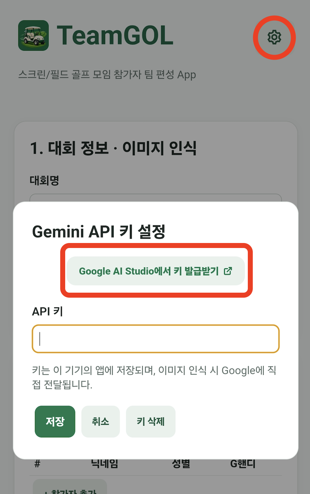
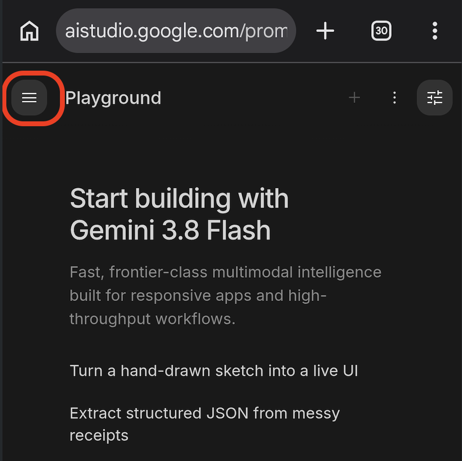
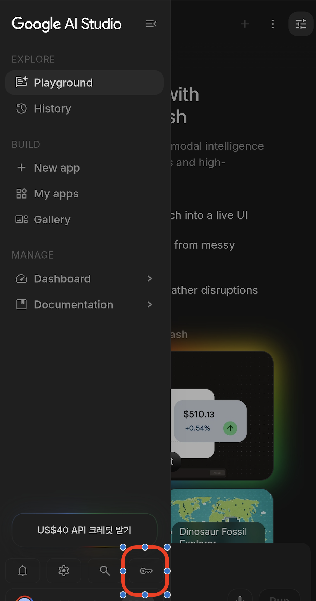
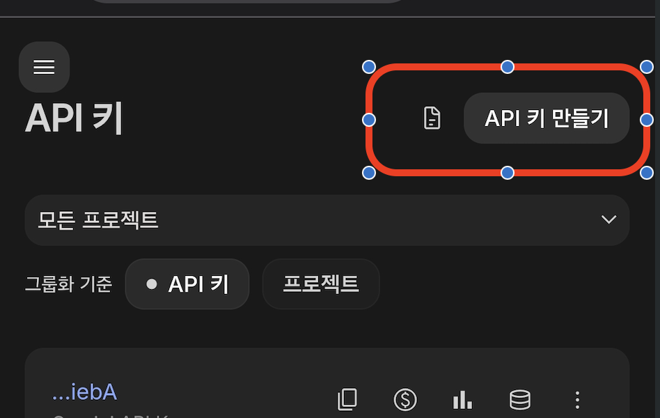
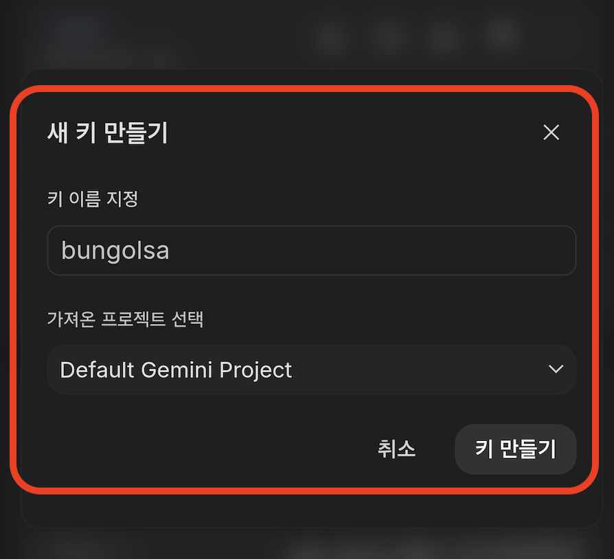
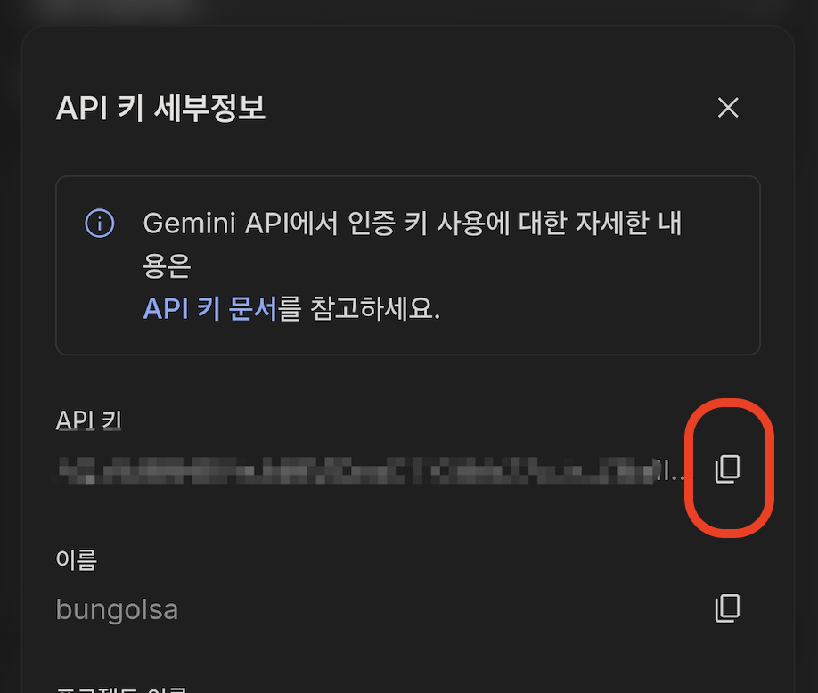
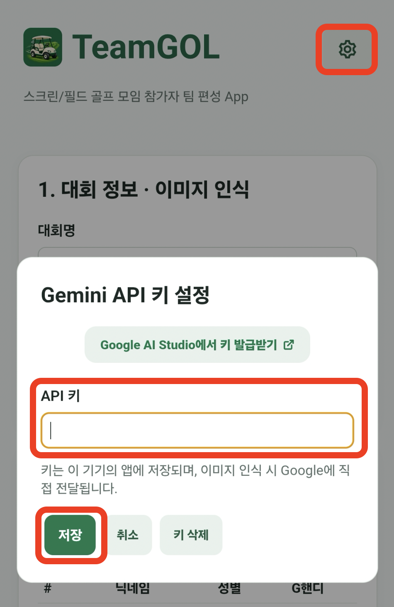

# TeamGOL 앱 사용 매뉴얼

## 1. 앱 소개

TeamGOL은 중고거래마켓내 골프(필드/스크린) 모임을 위한 팀편성 앱입니다. 이 앱은 OCR(Optical Character Recognition) 기능을 활용하여 구현되었으며, 내부적으로 Gemini 를 사용하고 있습니다. 때문에 본인의 Google 계정을 이용하여 API Key를 발급받아야 합니다.(무료티어 이용자들도 이용이 가능, 발급된 API Key는 본인 휴대폰내 저장)

> 주요 기능
- 팀 편성: 캡쳐 화면을 기반으로 팀 편성
- 팀 수정: 앞서 편성된 팀끼리 플레이어 교환
- 편성 내역 공유: 최종 편성된 내역에 대한 텍스트, 이미지 공유

## 2. 이용 전 준비 사항

> 설치하기 전에 안내드립니다

- Google의 OCR(Optical Character Recognition) 기능이 필수이므로 아래의 안내를 참고하여 본인의 Google 계정으로 API Key를 먼저 발급받아야 합니다. (무료 이용 가능)

> Google API Key 발급/등록 $\color{red}{\text{(최초 1회만 진행, 타인에게 API Key 공유 절대 금지!!)}}$.

- Step 1. 앱 실행 후 우측 상단의 "설정" 버튼 -> "Google AI Studio에서 키 발급받기" 누름
   

- Step 2. 아래 화면에서 "API 키 만들기"를 누르고, 키 이름을 임의로 정한 후 "키 만들기"를 눌러 생성. 
(Google AI Studio에 처음 접속하시는 분들은 일부 동의를 해야 이용가능하며, 필수 동의만 진행하시면 됩니다.)
   
   
   
   
   

- Step 3. API 키 세부정보에서 아래 붉은색 부분을 눌러 "복사" 후 앱으로 이동하여 붙여넣기 후 저장.
   

## 3. 설치 및 실행

1. [Google Play의 공식 앱 링크 또는 조직에서 안내한 배포 경로]에 접속합니다.
2. 앱 이름과 배포자 `[입력 필요]`를 확인한 후 설치합니다.
3. 설치가 완료되면 **열기**를 누르거나 홈 화면의 앱 아이콘을 누릅니다.
4. 첫 실행 안내가 나타나면 내용을 확인하고 진행합니다.

> 화면 예시 삽입: 앱 설치 화면, 앱 아이콘, 첫 실행 화면

## 4. 첫 실행 설정

### 4.1 로그인 [기능이 있는 경우]

1. 로그인 화면에서 [이메일 / 아이디 / 조직 계정 등 실제 로그인 방식]을 선택합니다.
2. [필요한 로그인 정보]를 입력합니다.
3. **[실제 로그인 버튼 이름]**을 누릅니다.
4. 홈 화면이 표시되면 로그인이 완료된 것입니다.

계정이 없거나 비밀번호를 잊은 경우에는 [회원가입 절차 / 비밀번호 재설정 방법 / 관리자 문의 방법]을 따릅니다.

### 4.2 앱 권한 설정

앱에서 권한 요청 화면이 표시되면 사용 목적을 확인한 후 허용 여부를 선택합니다. 아래 표는 작성용 예시이며, 실제로 요청하는 권한만 남겨 주세요.

| 권한 | 사용 목적 | 허용하지 않을 때의 영향 |
| --- | --- | --- |
| 알림 | [입력 필요] | [입력 필요] |
| 카메라 | [입력 필요] | [입력 필요] |
| 사진 및 동영상 | [입력 필요] | [입력 필요] |
| 위치 | [입력 필요] | [입력 필요] |

권한을 변경하려면 기기의 **설정 → 앱 → [앱 이름] → 권한**에서 확인합니다. 기기와 Android 버전에 따라 메뉴 이름과 위치가 다를 수 있습니다.

## 5. 화면 구성

> 화면 예시 삽입: 홈 화면에 번호를 표시하고 아래 설명과 연결

| 화면 또는 메뉴 | 설명 |
| --- | --- |
| [메뉴 이름 1] | [표시되는 정보와 사용 목적] |
| [메뉴 이름 2] | [표시되는 정보와 사용 목적] |
| [메뉴 이름 3] | [표시되는 정보와 사용 목적] |
| [설정 메뉴 이름] | [변경할 수 있는 설정] |

## 6. 주요 기능 사용하기

각 기능은 사용자가 하려는 일을 제목으로 작성합니다. 아래 내용을 실제 기능에 맞게 바꾸고, 필요한 만큼 추가하세요. 버튼 이름은 앱에 표시되는 문구와 동일하게 작성합니다.

### 6.1 [작업 1: 예 — 항목 조회하기]

**사용 목적:** [이 기능으로 할 수 있는 일]

**시작 전 확인:** [로그인, 사용 권한 등 필요한 조건. 없으면 삭제]

1. 홈 화면에서 **[메뉴 이름]**을 누릅니다.
2. [검색어 입력 또는 조회 조건 선택 등 실제 조작]을 합니다.
3. **[버튼 이름]**을 누릅니다.
4. [완료 후 표시되는 결과]를 확인합니다.

> 화면 예시 삽입: 메뉴 진입 → 조건 입력 → 조회 결과

### 6.2 [작업 2: 예 — 새 항목 등록하기]

**사용 목적:** [이 기능으로 할 수 있는 일]

1. **[메뉴 이름]**에서 **[등록 버튼 이름]**을 누릅니다.
2. 다음 내용을 입력합니다.

| 입력 항목 | 필수 여부 | 입력 방법 |
| --- | --- | --- |
| [항목 이름 1] | [필수 / 선택] | [형식과 예시] |
| [항목 이름 2] | [필수 / 선택] | [형식과 예시] |

3. 입력 내용을 확인하고 **[저장 버튼 이름]**을 누릅니다.
4. [완료 메시지 또는 목록]에서 등록 결과를 확인합니다.

**참고:** [임시 저장 여부, 입력 제한, 중복 등록 시 처리 등 확인된 동작]

### 6.3 [작업 3: 예 — 등록한 항목 수정 또는 삭제하기]

1. **[메뉴 이름]**에서 대상 항목을 선택합니다.
2. **[수정 버튼 이름]**을 눌러 내용을 변경한 뒤 **[저장 버튼 이름]**을 누릅니다.
3. 삭제하려면 **[삭제 버튼 이름]**을 누르고 확인 화면의 안내에 따라 진행합니다.
4. 변경 결과를 확인합니다.

**삭제 전 확인:** [삭제 가능 조건, 복구 가능 여부, 다른 사용자에게 미치는 영향]

## 7. 설정 및 계정 관리 [제공하는 항목만 유지]

| 하려는 일 | 사용 방법 |
| --- | --- |
| 알림 설정 변경 | [메뉴 경로와 변경 방법] |
| 내 정보 확인 또는 수정 | [메뉴 경로와 수정 가능한 항목] |
| 로그아웃 | [메뉴 경로와 버튼 이름] |
| 앱 버전 확인 | [메뉴 경로] |
| 계정 탈퇴 | [메뉴 경로, 처리 절차, 데이터 처리 안내] |

## 8. 자주 묻는 질문 및 문제 해결

### 앱이 실행되지 않아요.

앱을 종료한 후 다시 실행합니다. 문제가 계속되면 기기를 재시작하고, 공식 배포 경로에서 업데이트가 있는지 확인합니다. 해결되지 않으면 아래 문의 방법을 이용하세요.

### 로그인이 되지 않아요.

인터넷 연결과 입력한 계정 정보를 확인합니다. 비밀번호 재설정 또는 계정 권한 확인이 필요한 경우 [앱 내 절차 또는 문의처]를 이용합니다.

### 특정 기능을 사용할 수 없어요.

화면에 표시되는 안내 메시지를 확인합니다. 해당 기능에 필요한 앱 권한과 계정의 사용 권한을 확인한 후 다시 시도합니다.

### 저장하거나 전송한 내용이 보이지 않아요.

[앱에서 제공하는 저장 상태 확인 방법과 새로고침 절차]를 따릅니다. 저장 또는 전송 여부가 불확실하면 중복으로 제출하기 전에 [처리 상태 확인 방법 또는 문의처]를 통해 확인합니다.

### 알림이 오지 않아요.

앱 내 알림 설정과 기기의 앱 알림 허용 여부를 확인합니다. 자세한 설정 방법은 [해당 기기에서 확인한 경로]를 참고하세요.

## 9. 이용 시 참고 사항

- 계정과 비밀번호를 다른 사람에게 공유하지 마세요.
- 공용 기기에서 사용한 경우 이용을 마친 후 로그아웃하세요. [로그인 기능이 있는 경우]
- 앱 삭제나 데이터 초기화 전에 [기기에만 저장되는 데이터 유무 및 백업 방법]을 확인하세요.
- 개인정보 처리 안내: [개인정보처리방침 링크]
- 서비스 이용 안내: [이용약관 또는 운영 안내 링크]

## 10. 문의하기

문제가 해결되지 않으면 다음 정보와 함께 문의해 주세요. 비밀번호나 인증번호는 보내지 마세요. 화면을 첨부할 때는 개인정보를 가려 주세요.

- 문의처: [이메일 / 전화번호 / 앱 내 문의 메뉴]
- 운영 시간: [요일 및 시간]
- 문의 시 필요한 정보: 기기 모델, Android 버전, 앱 버전, 발생 시각, 문제 발생 전 조작 순서, 오류 메시지

## 부록. 배포 전 작성자 확인 목록

- [ ] 앱 이름, 버전, 지원 Android 버전, 문의처를 입력했습니다.
- [ ] 실제로 제공하지 않는 기능과 작성용 안내를 삭제했습니다.
- [ ] 메뉴 및 버튼 이름을 실제 앱과 일치시켰습니다.
- [ ] 설치부터 주요 작업 완료까지 실제 기기로 따라 해 보았습니다.
- [ ] 권한 거부, 로그인 실패, 저장 실패 시 안내를 확인했습니다.
- [ ] 삭제, 탈퇴, 데이터 초기화의 영향을 확인했습니다.
- [ ] 화면 이미지를 추가하고 개인정보를 가렸습니다.
- [ ] 모든 링크와 문의 경로가 정상적으로 작동하는지 확인했습니다.
