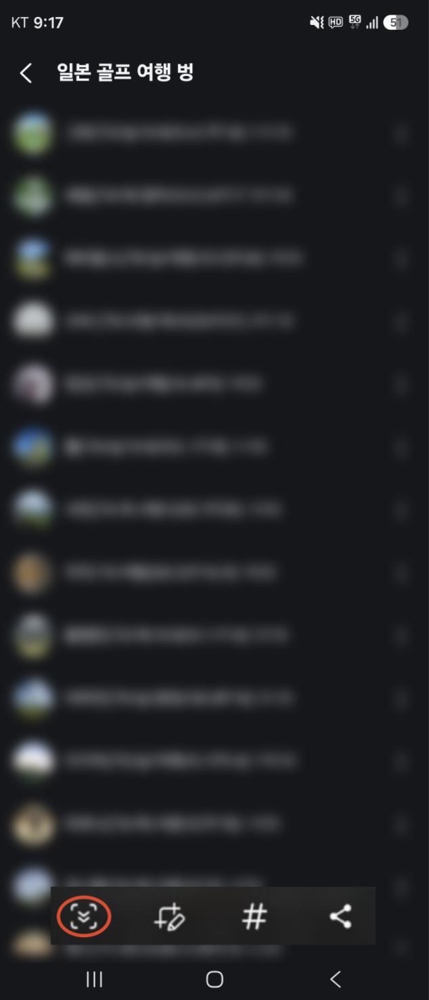
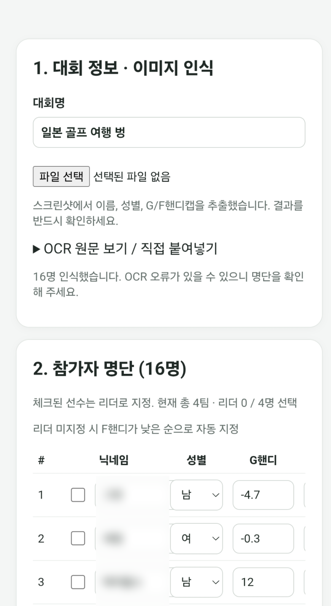

# TeamGOL 앱 사용 매뉴얼

## 1. 앱 소개

TeamGOL은 중고거래마켓내 골프(필드/스크린) 모임을 위한 팀편성 앱입니다. 이 앱은 OCR(Optical Character Recognition) 기능을 활용하여 구현되었으며, 내부적으로 Gemini 를 사용하고 있습니다. 때문에 본인의 Google 계정을 이용하여 API Key를 발급받아야 합니다.(무료티어 이용자들도 이용이 가능, 발급된 API Key는 본인 휴대폰내 저장)

> 주요 기능
- 팀 편성: 캡쳐 화면을 기반으로 팀 편성
- 팀 수정: 앞서 편성된 팀끼리 플레이어 교환
- 편성 내역 공유: 최종 편성된 내역에 대한 텍스트, 이미지 공유

## 2. 이용 전 준비 사항

> 설치하기 전에 안내 사항

- Google의 OCR(Optical Character Recognition) 기능이 필수이므로 아래의 안내를 참고하여 본인의 Google 계정으로 API Key를 먼저 발급받아야 합니다. (무료 이용 가능)

### Google API Key 발급/등록 $\color{red}{\text{(최초 1회만 진행, 타인에게 API Key 공유 절대 금지!!)}}$ ###

#### Step 1. 앱 실행 후 우측 상단의 "설정" 버튼 -> "Google AI Studio에서 키 발급받기" 누름 ####

* Google AI Studio에 처음 접속하시는 분들은 일부 동의를 해야 이용가능하며, 필수 동의만 진행하시면 됩니다.

#### Step 2. 좌측 상단의 ☰ 메뉴(아래 붉은 영역)를 누른다 ####

#### Step 3. 메뉴 하단에 열쇠 모양의 버튼을 누른다 ####

#### Step 4. 우측 상단의 "API Key 만들기" 버튼을 누른다 ####

#### Step 5. 키 이름은 임의로 지정, 프로젝트는 그대로 두고 "키 만들기" 버튼을 누른다 ####

#### Step 5. 아래 붉은색 버튼을 눌러 생성된 key를 복사한다 ####

#### Step 6. 다시 TeamGOL앱으로 돌아와 "API 키" 부분에 복사한 key를 붙여넣고, "저장" 버튼을 누른다 ####

## 3. 실행 및 이용

#### Step 1. 당근 모임 참석자 리스트를 캡쳐
> 참가자가 10여명이 초과하여 한 화면에 캡쳐가 안되는 경우 갤럭시의 "스크롤 캡쳐 기능" 활용 (스크롤 캡쳐 기능은 캡쳐 후 나타나는 아래 붉은 버튼을 화면이 끝날 때까지 클릭

#### Step 2. 앱 첫 화면에서 "파일선택"을 누른 후 캡쳐한 참석자 사진 선택 후 잠시 대기
* 아래와 같이 참석자 정보가 나오면 이미지 인식이 완료되었으므로 정보가 맞는지 확인
  - 대회명: 이미지에서 자동 인식
  - 참가자 정보: 이미지에서 자동 인식 (닉네임, 성별, G핸디, F핸디)
> 닉네임 앞 체크박스는 방/카트 별 리더이며, 리더끼리는 같은 팀이 될 수 없습니다. 체크박스가 없는 경우 F핸디가 상위인 플레이어가 임의로 지정됩니다.

#### Step 3. 참석자 정보(닉네임, 성별, G핸디, F핸디) 확인
* 닉네임 양식이 표준 규칙 "닉네임(생년월일/성별/G핸디/F핸디)" 에 맞지 않는 경우 일부 $\color{red}{\text{(오인식(붉은색))}}$ 되어 개별 수정 필요.
* 핸디 미표시된 경우 임의로 50을 부여함.

#### Step 4. 팀편성 기준 선택
* 팀당인원: 스크린의 경우 방하나당 플레이어 수, 필드의 경우 카트당 플레이어 수
* 완전랜덤/실력기준/성별+실력기준 중 택1
  - 완전랜덤: 임의로 편성.
  - 실력기준: 핸디 기준으로 팀별로 고르게 편성
  - 성별+실력기준: 성별+핸디가 최대한 고르게 편성
* 실력평가 기준: G핸디/F핸디 중 택1

"팀자동편성/재편성" 버튼 누름.
